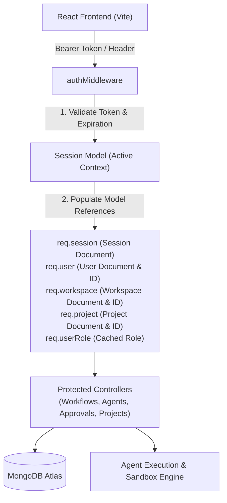

# PRAXIS — Multi-Agent Orchestration Platform (Backend Architecture Plan)

PRAXIS is an enterprise-grade AI agent orchestration platform designed for complex engineering workflows, deterministic guardrails (OKF), RAG-powered codebase indexing, and human-in-the-loop approval gates.

---

## 🏛️ System Architecture



---

## 📑 1. Frontend Audit & Data Requirements Mapping

Based on the frontend components in `client/src/`:

| Frontend View / Component | UI Actions & State Triggers | Backend Model / Service |
|---|---|---|
| **AuthPage (`SignIn`/`SignUp`)** | Login, registration, session persistence, GitHub OAuth | `User`, `Session`, `Workspace` |
| **TopHeader & Sidebar** | Active project switcher, breadcrumbs, unread alerts count, user badge | `Session.project`, `Session.workspace`, `Notification` |
| **Projects & Repositories** | Connect codebase, branch selector, AST tree indexing status | `Project`, `Workspace` |
| **Workflows & Workflow Runs** | Launch orchestrator (Parallel/Sequential), view execution graphs, historical runs | `Workflow`, `WorkflowRun` |
| **Agent Library & Details** | 10-stage autonomous test loop, coverage deltas, token usage | `Agent`, `AgentRun` |
| **Approvals Gate** | Human-in-the-loop authorization (`appr-001`, `appr-002`), risk indicators, audit logs | `ApprovalGate`, `ApprovalHistory` |
| **RAG & OKF Policies** | Vector search explorer, 80/20 unified context, deterministic guardrail rules | `RagSource`, `OkfPolicy` |
| **Tools & Sandbox** | Process monitor, Jest test runner terminal, container boundaries | `ToolExecution`, `SandboxProcess` |
| **Execution Logs** | Live log stream, log levels (`INFO`, `WARN`, `ERROR`, `DEBUG`) | `ExecutionLog` |
| **Reports** | Synthesized markdown reports, CWE-89 security remediation, PDF export | `Report` |
| **Analytics** | Success rates, agent benchmarks, daily run volumes, token throughput | `AnalyticsSnapshot` |
| **Team Management** | Team contributors, RBAC roles (`Owner / Admin`, `Staff Engineer`, `DevOps Lead`) | `Workspace.members`, `User` |
| **Settings** | Device sessions revoke, scoped API tokens (`px_live_...`), LLM Gateway, VectorDB | `Session`, `ApiKey`, `PlatformConfig` |

---

## 🗄️ 2. Database Models & Schema Design (MongoDB / Mongoose)

### A. Session Model (`server/models/Session.js`)
> **Core Requirement:** Stores references to all active models and their IDs to be injected directly into Express request context (`req`).

* **`token`**: `String` (Indexed, unique session identifier)
* **`user`**: `ObjectId` ref `'User'` (Required, active logged-in user)
* **`workspace`**: `ObjectId` ref `'Workspace'` (Required, active organization workspace)
* **`project`**: `ObjectId` ref `'Project'` (Active project context for current work)
* **`role`**: `String` (Cached role for fast zero-lookup authorization)
* **`device`**:
  * `ip`: `String`
  * `userAgent`: `String`
  * `browser`: `String`
  * `os`: `String`
  * `clientType`: Enum (`'browser'`, `'cli'`, `'api'`)
* **`isValid`**: `Boolean` (Default: `true`)
* **`expiresAt`**: `Date` (TTL Indexed for automatic document expiration)
* **`lastActive`**: `Date` (Default: `Date.now`)

### B. User Model (`server/models/User.js`)
* **`name`**: `String` (Required)
* **`email`**: `String` (Unique, required, lowercase, trimmed)
* **`password`**: `String` (Bcrypt hashed, hidden by default with `select: false`)
* **`role`**: Enum (`'Workspace Admin'`, `'developer'`, `'viewer'`, `'admin'`)
* **`initials`**: `String` (e.g., `"AP"`)
* **`avatar`**: `String` (URL or null)
* **`activeWorkspace`**: `ObjectId` ref `'Workspace'`
* **`activeProject`**: `ObjectId` ref `'Project'`
* **`provider`**: Enum (`'local'`, `'github'`)
* **`twoFactorEnabled`**: `Boolean` (Default: `false`)

### C. Workspace Model (`server/models/Workspace.js`)
* **`name`**: `String` (e.g., `"Acme Corp"`)
* **`slug`**: `String`
* **`owner`**: `ObjectId` ref `'User'`
* **`plan`**: Enum (`'Free'`, `'Pro'`, `'Enterprise'`, `'Enterprise Dedicated Swarm'`)
* **`members`**: Array of `{ user: ObjectId ref 'User', role: String, joinedAt: Date }`

### D. Project Model (`server/models/Project.js`)
* **`name`**: `String` (e.g., `"payments-api"`)
* **`workspace`**: `ObjectId` ref `'Workspace'`
* **`repo`**: `String` (e.g., `"github.com/acme/payments-api"`)
* **`branch`**: `String` (Default: `"main"`)
* **`language`**: `String` (`"Node.js"`, `"TypeScript"`, `"Go"`, `"Python"`)
* **`framework`**: `String` (`"Express"`, `"React"`, `"FastAPI"`)
* **`health`**: Enum (`'healthy'`, `'warning'`, `'error'`)
* **`ragStatus`**: Enum (`'indexed'`, `'indexing'`, `'failed'`, `'pending'`)
* **`ragChunks`**: `Number` (Vector count)
* **`lastIndexed`**: `Date`

### E. Workflow & Execution Models (`Workflow.js`, `WorkflowRun.js`)
* **`Workflow`**: Task prompt, execution mode (`parallel` / `sequential`), approval policy (`high-risk-only` / `all` / `none`), status (`running`, `completed`, `failed`), progress percentage.
* **`WorkflowRun`**: Historical execution traces, token consumption, retries, step results.

### F. Approval Gate Model (`ApprovalGate.js`)
* **`workflow`**: `ObjectId` ref `'Workflow'`
* **`action`**: `String` (e.g., `"Deploy auth-service to production"`)
* **`risk`**: Enum (`'critical'`, `'high'`, `'medium'`, `'low'`)
* **`status`**: Enum (`'pending'`, `'approved'`, `'rejected'`)
* **`decidedBy`**: `ObjectId` ref `'User'`
* **`decisionDate`**: `Date`
* **`affectedFiles`**: `[String]`

---

## 🛡️ 3. Authentication & Context-Injection Middleware (`authMiddleware.js`)

The authentication middleware verifies the incoming JWT / Bearer token, fetches the active `Session` from MongoDB, populates model references, and attaches them directly onto `req`:

```javascript
// Example context injection inside authMiddleware.js:
req.session = session;
req.sessionId = session._id;

req.user = session.user;             // Populated User Document
req.userId = session.user._id;

req.workspace = session.workspace;   // Populated Workspace Document
req.workspaceId = session.workspace?._id;

req.project = session.project;       // Populated Project Document
req.projectId = session.project?._id;

req.userRole = session.role || session.user.role;
```

### Context Switching API
Allows changing the active project or workspace on the live session without re-authenticating:
* `PATCH /api/auth/switch-context`: Updates `session.project` or `session.workspace` and returns updated tokens/context.

---

## 📡 4. RESTful API Routes Specification

### A. Authentication & Session Management (`/api/auth`)
* `POST   /api/auth/register` — Create account, auto-create default workspace & project, issue session token.
* `POST   /api/auth/login` — Verify credentials, create new device session, return token and active context.
* `POST   /api/auth/logout` — Invalidate current session (`isValid: false`).
* `GET    /api/auth/me` — Return current authenticated user, active workspace, active project, and session info.
* `PATCH  /api/auth/switch-context` — Switch active project or workspace for the session.
* `GET    /api/auth/sessions` — List all active device sessions for current user (Settings view).
* `DELETE /api/auth/sessions/:id` — Revoke a specific device session.
* `DELETE /api/auth/sessions` — Revoke all other sessions except current.

### B. Projects & Repositories (`/api/projects`)
* `GET    /api/projects` — List all projects in active workspace.
* `POST   /api/projects/connect` — Connect new repository with branch and AST indexing flags.
* `GET    /api/projects/:id` — Get project details, health metrics, and vector statistics.
* `DELETE /api/projects/:id` — Disconnect repository.

### C. Workflows & Multi-Agent Orchestration (`/api/workflows`)
* `GET    /api/workflows` — List workflows with status filters (Running, Completed, Blocked, Failed).
* `POST   /api/workflows/launch` — Launch new multi-agent orchestrator workflow.
* `GET    /api/workflows/:id` — Full workflow details (Pipeline steps, 80/20 Context, Artifacts, Live Logs).
* `POST   /api/workflows/:id/cancel` — Cancel ongoing workflow execution.
* `GET    /api/workflows/runs` — Get active and historical workflow runs.

### D. Approvals & Governance (`/api/approvals`)
* `GET    /api/approvals/pending` — Get pending human authorization gates.
* `POST   /api/approvals/:id/approve` — Authorize action and resume workflow pipeline.
* `POST   /api/approvals/:id/reject` — Reject action and abort step.
* `GET    /api/approvals/history` — Audit trail of all governance decisions.

### E. Agent Library & Diagnostics (`/api/agents`)
* `GET    /api/agents` — List available agent profiles with capability tags.
* `GET    /api/agents/:id` — Detailed autonomous test loop visualizer data.
* `GET    /api/agents/runs` — Agent runs history and token consumption.

### F. RAG Knowledge & OKF Policies (`/api/rag`, `/api/okf`)
* `GET    /api/rag/sources` — List indexed codebases and vector database shards.
* `POST   /api/rag/query` — Semantic code embedding search with cosine similarity scores.
* `GET    /api/okf/policies` — List deterministic guardrail policies.
* `PATCH  /api/okf/policies/:id/toggle` — Enable or disable specific OKF rule.

### G. Telemetry & Logs (`/api/logs`)
* `GET    /api/logs` — Query execution logs with level and agent filters.
* `GET    /api/logs/stream` — Server-Sent Events (SSE) live execution terminal feed.
* `GET    /api/analytics` — KPI deltas, token usage trends, and reliability distributions.

---

## 🚀 5. Implementation Roadmap

```
Phase 1: Authentication & Session Foundation
  ├── Models: User, Workspace, Project, Session
  ├── Middleware: authMiddleware (Context & ID injection)
  └── Routes: Auth controller, Login, Register, Session Manager, Context Switcher

Phase 2: Projects, Repositories & Workspace Sync
  ├── Project CRUD & Connect Repo Endpoint
  └── Workspace member management & roles

Phase 3: Workflows & Agent Orchestration Engine
  ├── Launch workflow (Parallel vs Sequential execution modes)
  ├── 10-Stage autonomous test loop tracking
  └── Approvals gate with audit logging

Phase 4: Telemetry, RAG & Frontend Integration
  ├── Execution logs query and live stream
  ├── Vector database & OKF policy toggle endpoints
  └── Frontend API service layer (client/src/api/) replacing mock data
```

