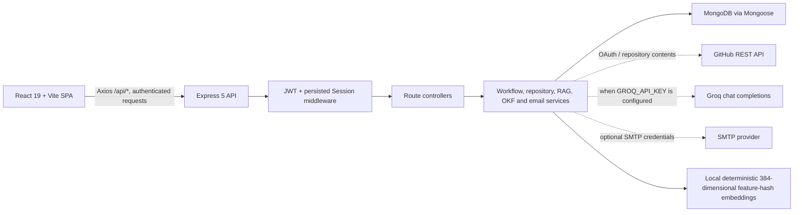

# PRAXIS

PRAXIS is a React and Express application for connecting code repositories, indexing source for retrieval, managing workspace-level OKF policies, and running multi-agent engineering workflows. The current implementation combines MongoDB-backed application data with an optional Groq model integration and a deterministic local fallback.

> **Implementation status:** This README describes the code currently present in the repository, not a product roadmap. Some dashboard sections are visual prototypes or use sample data; limitations are called out below.

## Contents

- [System architecture](#system-architecture)
- [Project workflow](#project-workflow)
- [Implemented features](#implemented-features)
- [Frontend dashboard areas](#frontend-dashboard-areas)
- [Backend API](#backend-api)
- [Data model](#data-model)
- [Technology stack](#technology-stack)
- [Getting started](#getting-started)
- [Configuration](#configuration)
- [Known limitations and prototype areas](#known-limitations-and-prototype-areas)
- [Development commands](#development-commands)

## System architecture



### Runtime responsibilities

- **Client (`client/`)**: A single-page React application. `AppRoutes` provides public landing, sign-in/sign-up, invitation acceptance, and a protected dashboard route. The dashboard composes feature views and calls the backend through the Axios service layer.
- **API (`server/`)**: Express mounts feature routers under `/api`. Protected routers use `authenticate`, which verifies a bearer JWT, checks its matching active MongoDB session and expiry, then attaches user, workspace, project, and role context to the request.
- **Persistence (`server/models/`)**: Mongoose models store users, sessions, workspaces, projects, workflow and agent runs, approvals, notifications, policies, and vector chunks.
- **Repository ingestion (`server/services/`)**: Repository files are fetched from GitHub or read from a matching local directory, divided into overlapping line-based chunks, embedded locally, and stored in MongoDB.
- **Workflow execution**: Launching a workflow starts an asynchronous in-process orchestration function. It reads indexed context and enabled OKF policies, calls Groq when configured (otherwise uses a deterministic local fallback), and persists workflow/agent run state.

The application does **not** currently use a separate vector database, message broker, durable job queue, or execution sandbox. The vector search implementation reads MongoDB documents and calculates cosine similarity in application code.

## Project workflow

1. **Create a session.** Register with email and password, sign in, or use GitHub OAuth. Registration creates a user and a default workspace; it does not create a sample project. The API issues a seven-day JWT and stores the corresponding session in MongoDB.
2. **Connect a repository.** The dashboard can select a GitHub repository (after OAuth) or accept a repository URL. The backend creates a project and, when ingestion is enabled, retrieves eligible files and indexes them. A new project is removed along with its partial vector/policy records if the ingestion pipeline fails.
3. **Build retrieval context.** Source files with supported extensions are split into 45-line chunks with an 8-line overlap. A deterministic local feature-hashing function creates 384-dimensional normalized vectors. RAG queries score stored vectors using cosine similarity and can be scoped to a project or workspace.
4. **Configure governance.** OKF policies can be generated during repository ingestion or managed through the policy API. Policies are stored per project/workspace and may be created, enabled/disabled, or deleted.
5. **Launch a workflow.** A user supplies a task name/prompt, project, branch, execution mode (`parallel` or `sequential`), and approval policy (`high-risk-only`, `all`, or `none`). The backend creates a workflow and initial run record, then starts the orchestration pipeline.
6. **Inspect execution.** Workflow and agent run records, approval gates, and notifications are persisted in MongoDB. The dashboard polls for updates while it sees active workflows.
7. **Record a human decision.** An approval can be approved or rejected. The decision and workflow status are written to MongoDB and a notification is created.

### Workflow pipeline

The current orchestration pipeline has four roles:

1. Code Analysis Agent
2. Unit Test Agent
3. Security Auditor Agent
4. DevOps Deployer Agent

Parallel mode calls the first three model roles concurrently, then evaluates the DevOps role. Sequential mode calls each role in order. The pipeline provides repository context and enabled OKF policies to Groq as structured JSON evaluation instructions. When Groq is unavailable or not configured, a local fallback performs limited pattern checks. Workflow execution is asynchronous in the API process, not managed by a persistent worker.

## Implemented features

### Authentication and workspace access

- Email/password registration and sign-in; passwords are hashed with bcrypt.
- JWT-backed sessions persisted with user, workspace, project, device information, activity time, and expiry.
- Authenticated session validation and request-context injection.
- Switch the active workspace or project without signing in again.
- List active device sessions and revoke all other sessions.
- GitHub OAuth account linking/sign-in and repository listing.
- Workspace invitations using signed, seven-day invitation tokens; accept invitations and create/link a user.
- Workspace member listing, invitation, role update, and removal endpoints.
- Invitation email delivery through configured SMTP, with a local-development link-log fallback when SMTP credentials are absent.

### Projects and repositories

- List, inspect, connect, and disconnect projects scoped to a workspace.
- Select a branch and optionally enable repository ingestion and OKF policy generation.
- Ingestion supports GitHub tree/content APIs, caller-provided files, and selected local directories.
- Project records track branch, user-provided or simply inferred language/framework values, health, indexing status, chunk count, and last indexing time. The current inference is based on repository-name heuristics, not source analysis.
- Deleting a project also removes its vector chunks, OKF policies, and RAG knowledge records.

### RAG and OKF governance

- Fixed-size, overlapping source chunking with file and line metadata.
- Locally generated 384-dimensional deterministic feature-hashing vectors stored in MongoDB.
- Cosine-similarity search scoped by project/workspace, with optional category, score threshold, and result limit.
- List indexed sources and chunk counts, reindex a repository, or index a supplied file.
- Generate repository-specific OKF policy records and apply a baseline policy set.
- Create, list, toggle, and delete project/workspace policies.

### Agents, workflows, approvals, and notifications

- Seed a four-agent library when the agent collection is empty.
- Launch parallel or sequential workflow runs and inspect workflows, workflow runs, agents, and agent runs.
- Record the model/fallback evaluation summary, token estimate, duration, and run status.
- Create pending approval gates when policy checks or workflow policy require a human decision.
- Approve/reject gates and view pending approvals and decision history.
- List notifications, mark one or all as read, and delete notifications.

## Frontend dashboard areas

The dashboard navigation currently includes these views:

| View | Current data/behavior |
|---|---|
| Overview | Uses live workflow/project/agent state where available; some displayed KPI values are fixed presentation values. |
| Projects | Uses project API data and supports project selection and workflow/repository actions. |
| Repositories | Uses project API data for repository management and disconnect actions. |
| Workflows, workflow runs, workflow detail | Uses workflow and run API data; workflow launch is available from the dashboard. |
| Agents, agent runs, agent detail | Uses agent library and agent-run API data. |
| RAG | Uses source listing, vector query, and indexing APIs. |
| OKF policies | Uses policy list/create/toggle/delete and baseline APIs. |
| Approvals | Uses pending-approval and history APIs; decisions are persisted. |
| Team | Uses workspace member and invitation APIs. |
| Notifications | Uses notification APIs, including mark-all-read. |
| Tools | Uses in-memory sample tool and execution data; no tool-execution API is mounted. |
| Logs | Displays local sample entries and a simulated live-feed notification; no logs API is mounted. |
| Analytics | Displays static sample metrics; no analytics API is mounted. |
| Reports | Displays sample report content; export/copy/share controls currently show UI feedback rather than generating or storing report artifacts. |

The command palette, mobile navigation, toast notifications, and keyboard shortcuts (`Ctrl/Cmd+K`, `Escape`) are client-side dashboard interactions.

## Backend API

All API routes are mounted by `server/server.js`. Unless indicated as public, endpoints require `Authorization: Bearer <token>` and an active server-side session.

| Base path | Methods and paths | Purpose |
|---|---|---|
| `/api/auth` | `POST /register`, `POST /login`, `GET /me`, `POST /logout`, `PATCH /switch-context`, `GET /sessions`, `DELETE /sessions/others`, `GET /github`, `GET /github/callback` | Registration, login, session context and revocation, GitHub OAuth. `/register`, `/login`, and GitHub OAuth are public. |
| `/api/workspaces` | `GET /invite-details`, `POST /accept-invite`, `GET /current`, `GET /members`, `POST /members`, `PATCH /members/:id`, `DELETE /members/:id` | Invitation acceptance and workspace/member management. The two invitation endpoints are public. |
| `/api/projects` | `GET /`, `GET /github/repos`, `POST /connect`, `GET /:id`, `DELETE /:id`, `POST /:id/reindex` | Project and repository operations. All routes require authentication. |
| `/api/workflows` | `GET /`, `POST /launch`, `GET /runs`, `GET /:id`, `POST /:id/cancel` | Workflow launch, status, cancellation request, and run history. |
| `/api/agents` | `GET /`, `GET /runs`, `GET /:id` | Agent library and run records. |
| `/api/approvals` | `GET /pending`, `GET /history`, `POST /:id/decision`, `POST /:id/approve`, `POST /:id/reject` | Approval gate queue, history, and decisions. |
| `/api/notifications` | `GET /`, `PATCH /mark-read`, `PATCH /:id/read`, `DELETE /:id` | User notification management. |
| `/api/rag` | `GET /sources`, `POST /query`, `POST /reindex`, `POST /index-file` | Source listing, semantic search, repository reindex, and one-file indexing. |
| `/api/okf` | `GET /policies`, `POST /policies`, `POST /policies/baseline`, `PATCH /policies/:id/toggle`, `DELETE /policies/:id` | OKF policy management. |

## Data model

The MongoDB schemas in `server/models/` cover:

| Model | Responsibility |
|---|---|
| `User` | Account identity, bcrypt password hash, role, active workspace/project, GitHub profile/token. |
| `Session` | JWT-backed active session, context references, device details, activity and expiry. |
| `Workspace` | Owner, plan fields, and workspace members/roles. |
| `Project` | Repository identity, branch, language/framework, health, and RAG indexing status. |
| `Workflow` | Workspace/project task, execution and approval policies, progress, agent pipeline, and metrics. |
| `WorkflowRun` | Workflow execution trace records. |
| `Agent` | Agent metadata, capability/tool descriptions, model label, status, and run totals. |
| `AgentRun` | Per-agent task outcome, token/duration fields, coverage fields, and loop-step display data. |
| `ApprovalGate` | Approval request, risk, affected files, decision, and deciding user. |
| `Notification` | User-facing event and read state. |
| `OkfPolicy` | Workspace/project policy, rule text, category, risk, and enabled state. |
| `VectorEmbedding` | Source chunks, metadata, local vector, and project/workspace references. |
| `RagKnowledge` | Repository indexing metadata schema. |
| `ExecutionLog` | Execution log schema. |
| `ApiKey` | API-key metadata and hashed key schema. |
| `PlatformConfig` | LLM-routing and vector-store configuration schema. |

`RagKnowledge`, `ExecutionLog`, `ApiKey`, and `PlatformConfig` currently have schemas but no corresponding mounted management APIs. Their presence should not be read as evidence that those settings or services are fully operational.

## Technology stack

- **Frontend:** React 19, React Router 7, Vite 8, Tailwind CSS 4, Axios, Lucide icons, React Hot Toast.
- **Backend:** Node.js, Express 5, Mongoose 9, MongoDB.
- **Authentication/integrations:** JSON Web Tokens, bcryptjs, GitHub OAuth/REST API, Nodemailer.
- **AI and retrieval:** Groq SDK, local deterministic vector feature hashing, MongoDB-backed cosine-similarity retrieval.

## Getting started

### Prerequisites

- Node.js version compatible with the installed Vite 8 toolchain.
- npm.
- MongoDB (local or hosted).
- GitHub OAuth app credentials if GitHub sign-in/private repository listing is needed.
- Groq API key if live model-backed workflow evaluations are needed. The backend has a local fallback when this key is not configured.

### Install and run

Install dependencies separately for the two packages:

```powershell
cd server
npm install
```

```powershell
cd client
npm install
```

Create `server/.env` with the required database and authentication settings (see [Configuration](#configuration)), then start the API:

```powershell
cd server
npm run dev
```

In a second terminal, start the frontend:

```powershell
cd client
npm run dev
```

By default, the frontend is served by Vite at `http://localhost:5173` and the API listens on port `8080`. Open the Vite URL in a browser.

## Configuration

The backend loads environment variables from `server/.env`. Do not commit this file or put credentials in the README.

| Variable | Required | Purpose |
|---|---:|---|
| `MONGO_URI` or `ATLAS_URI` | Yes | MongoDB connection string. |
| `JWT_SECRET` | Yes for deployments | Secret used to sign and verify JWTs and invitation tokens. Set a unique, strong value; do not rely on the source-code fallback. |
| `PORT` | No | API port; defaults to `8080`. |
| `CLIENT_URL` | No | Frontend origin for OAuth redirects, invitation links, and CORS allow-listing. |
| `VITE_BACKEND_URL` | No | Frontend API base URL. Local browser hosts default to `http://localhost:8080`. Set this in the client environment for a remote API. |
| `GITHUB_CLIENT_ID`, `GITHUB_CLIENT_SECRET` | For OAuth | GitHub OAuth app credentials. |
| `GITHUB_CALLBACK_URL` | For deployed OAuth | Public callback URL; local fallback is based on `PORT` (the source fallback uses port `8000`). |
| `GITHUB_TOKEN` | Optional | Server-level token used when indexing repository files. A linked user's GitHub token takes precedence when available. |
| `GROQ_API_KEY` | Optional | Enables live Groq chat-completion calls for workflow agent evaluations. Without it, the deterministic fallback is used. |
| `GROQ_MODEL` | No | Groq model name; defaults to `qwen/qwen3.8-27b` in the current service code. |
| `EMAIL_HOST`, `EMAIL_PORT`, `EMAIL_USER`, `EMAIL_PASS` | Optional | SMTP connection for workspace invitation mail. |
| `EMAIL_SERVICE`, `EMAIL_FROM` | Optional | Nodemailer service/from-address configuration when applicable. |

The current CORS configuration allows the local Vite origins, `CLIENT_URL`, and development-tunnel origins.

## Known limitations and prototype areas

- The client API path constants include `/api/dashboard/*`, `/api/logs/*`, and analytics paths, but `server.js` does not mount dashboard, logs, or analytics routers. The corresponding dashboard screens are not backed by those APIs.
- Tools, logs, analytics, and reports contain hard-coded/sample UI state. Their visual labels should not be interpreted as live tool execution, telemetry, report generation, PDF export, clipboard export, or sharing.
- The implemented embeddings are deterministic token/n-gram feature hashes, not vectors from a pretrained semantic embedding model. Similarity is calculated by scanning candidate documents in MongoDB rather than a dedicated vector index.
- Repository chunking is line-based, and the source inspection helpers use regular expressions and simple structural checks; they are not a full language AST parser.
- The workflow pipeline asks the selected model to return analysis JSON and has a limited regex-based local fallback. It does not currently edit repository files, run the target repository's unit tests, launch a real sandbox, scan dependencies with Semgrep/Trivy, build containers, deploy to Kubernetes, or create pull requests.
- The dashboard's approval decision endpoint records the decision and updates workflow state, but does not resume a paused orchestration process. Workflow execution is also an in-process asynchronous task, not a durable job.
- `POST /api/projects/:id/reindex` currently updates project indexing fields with a generated chunk-count increment; use the RAG reindex endpoint for the ingestion pipeline instead.
- Registration and session setup require MongoDB to be reachable. No automated server test suite is configured (`server/package.json` has a placeholder test script).

## Development commands

Run commands from the corresponding package directory:

| Directory | Command | Description |
|---|---|---|
| `client/` | `npm run dev` | Start the Vite development server. |
| `client/` | `npm run build` | Build the frontend for production. |
| `client/` | `npm run preview` | Preview the production build locally. |
| `client/` | `npm run lint` | Run ESLint over the client. |
| `server/` | `npm run dev` | Start the API with Nodemon. |
| `server/` | `npm start` | Start the API with Node.js. |
| `server/` | `npm test` | Placeholder that exits with “Error: no test specified”. |
